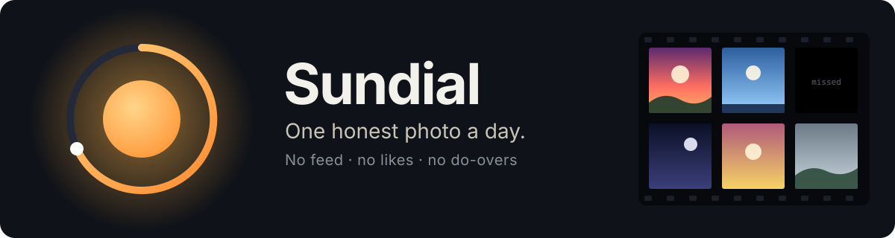
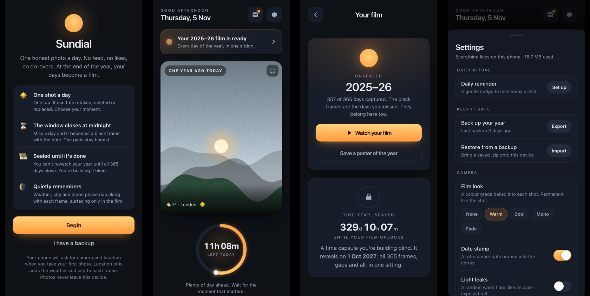
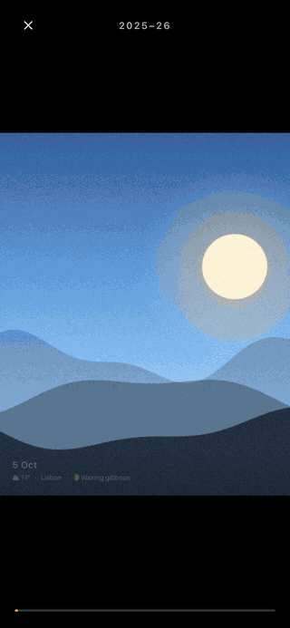

<div align="center">

**A camera that only lets you take one photo a day.** No retakes, no deleting, no second shot.
At the end of the year, every day plays back as a short film of your life.

[](https://kav-sw19.github.io/sundial/)


[](LICENSE)



</div>

## Why

Most cameras encourage you to take 40 near-identical photos and look at none of them. Sundial gives you **one shot a day**, so you stop and choose: the coffee, the kid, the sky, the mess on the floor, whatever actually mattered.

You can't rewatch the year while you're living it. It stays **sealed**, a time capsule you build without looking. When the year closes, all 365 days, gaps included, play back as a film of about three and a half minutes. Then the next year begins.

There's no feed, no likes, no account and no server. Your photos stay on your phone.

<div align="center">

<br><sub>A year, played back. Each day dissolves into the next. Missed days are black frames.</sub>
</div>

### The rules

| | Rule | Why |
|---|---|---|
| ☀️ | **One shot a day.** One tap commits it. No retake, no delete. | Scarcity makes you *choose the moment*. |
| ⏳ | **The window closes at midnight.** The dial fills as the day goes. | A small daily ritual: *have I taken it yet?* |
| ◼️ | **Missed days stay honest.** They become black frames with the date. | The gaps are part of the story. |
| 🎞️ | **The year is sealed.** No browsing and no film until it closes. | You build it blind, and the reveal is the payoff. |
| 🕐 | **One year ago today.** Before you shoot, you see this date last year. | One gentle look back each day. |
| 🌘 | **It quietly remembers.** Weather, city and moon phase ride along with every frame. | Memory without a dashboard. |
| 🔁 | **Year after year.** When a year unseals, the next starts sealed. | A life in chapters, each built blind. |

**[▶ Open Sundial on your phone](https://kav-sw19.github.io/sundial/)** and add it to your home screen ([how](#get-it-on-your-phone)).

---

## Contents

- [What's new in 2.0](#whats-new-in-20)
- [Features](#features)
- [Get it on your phone](#get-it-on-your-phone)
- [The daily reminder](#the-daily-reminder)
- [How a day works](#how-a-day-works)
- [The film and the seal](#the-film-and-the-seal)
- [Your data and privacy](#your-data-and-privacy)
- [Deploy your own copy](#deploy-your-own-copy)
- [Make it your own](#make-it-your-own)
- [Troubleshooting and FAQ](#troubleshooting-and-faq)
- [How it's built](#how-its-built)

---

## What's new in 2.0

- **Year after year.** Sundial now runs in back-to-back yearly cycles. Every unsealed year stays on the Film screen, and a "your film is ready" banner and badge tell you when a new one opens.
- **What you see is what you keep.** The viewfinder is the exact 4:5 crop that gets saved, with your film look applied live. A look picker sits next to the shutter.
- **Films on any phone.** The player decodes photos a few seconds ahead instead of all at once, so a full year plays smoothly without filling memory. Tap to pause.
- **Backups you can trust.** Restore works from the welcome screen, re-zipped backups are accepted, timestamps are real, and Settings reminds you if it's been a while.
- **Accessible.** Every sheet and overlay traps focus, closes with Escape and hands focus back. Text meets contrast requirements. Sundial supports reduced motion, reduced transparency and higher-contrast settings, and pinch-zoom works again.
- **Fixes.** The home screen rolls over at midnight while open. Two tabs can no longer overwrite a committed shot. Year two onwards gets its own film. 29 February no longer matches 1 March.

Earlier updates added film looks with grain and halation, the date stamp, light leaks, recording a film to video with a poster fallback, a server-free Android reminder, the 0.5× lens, ambient sound and contact-sheet posters.

---

## Features

### Capture
- **A 4:5 viewfinder that matches the saved frame**, with an optional rule-of-thirds grid.
- **Film looks**, baked in at capture and permanent like the shot itself:
  - Warm, Cool, Mono and Fade.
  - Each has its own grain, vignette and highlight bloom.
- **Date stamp**: an optional retro amber date burned into the corner, like a disposable camera.
- **Light leaks**: an optional random warm flare, like an over-exposed roll.
- **Lenses**: 0.5× (ultra-wide, on phones that have one) and 1×. Flipping to the front camera resets to 1×, and selfies are mirrored the way you saw them.
- **The moment's sound**: optionally, three seconds of audio recorded with the shot and played back in the viewer.
- **Captions** of up to 180 characters, added when you shoot or later.
- **Save to Photos**: a copy in your phone's gallery, if you want one.

### Memory
- **One year ago today**, full-screen, with a strip of the same date in earlier years once you have them.
- **Ambient details** on every frame: weather and temperature, city, and moon phase. The moon is calculated on the phone, so it works offline.

### The film
- One frame per day with a gentle dissolve, and every missed day as a black frame with its date.
- Captions and the ambient line fade in over each frame.
- **Save the film** as a video you can keep or share, with progress and a Cancel button. If your browser can't record video, you get the poster instead.
- **Poster of the year**: a printable contact sheet with every day as a tile.

### Looking after your year
- **Back up** everything (photos, captions, ambient data and sound) into one `.zip`, and **restore** it on any phone.
- **Daily reminder**: server-free on Android, and a one-time Shortcuts setup on iPhone.
- **Accent colours**: Amber, Rose, Teal, Violet and Sky.
- **Update banner**: when a new version ships, the app offers to reload.

---

## Get it on your phone

Sundial installs straight from the web. There's no app store, and you don't need to deploy anything yourself. Your photos are stored privately on *your* device, so the shared link is still genuinely yours.

**Open this on your phone: https://kav-sw19.github.io/sundial/**

<table>
<tr><th>iPhone</th><th>Android</th></tr>
<tr><td valign="top">

1. Open the link in **Safari**. Install only works in Safari, not Chrome.
2. **Share** → **Add to Home Screen** → **Add**.
3. Open **Sundial** from the icon and tap **Begin**.
4. Allow **Camera** and **Location** when asked on your first shot.

</td><td valign="top">

1. Open the link in **Chrome**.
2. **⋮** → **Install app** (or **Add to Home screen**).
3. Open Sundial and tap **Begin**.
4. Allow **Camera** and **Location** when asked.

</td></tr>
</table>

> [!IMPORTANT]
> **Launch it from the home-screen icon.** That's what makes Sundial run full-screen, work offline and keep your photos durably. A normal browser tab works, but the browser may clear its storage, so don't trust a year to a tab.

---

## The daily reminder

One gentle nudge a day to take your shot, and to see last year's.

- **Android:** go to **⚙️ Settings → Daily reminder → Set up** and allow notifications. Chrome wakes Sundial roughly once a day using Periodic Background Sync, with no server involved. It nudges you only if today's shot hasn't been taken. Tap **Turn off** in the same place to stop it.
- **iPhone:** Apple doesn't let web apps wake themselves on a timer, so you set up a free one-time automation in **Shortcuts**. The in-app guide at **⚙️ Settings → Daily reminder** has the exact steps:
  1. **Shortcuts** → **Automation** → **+** → **Time of Day**. Choose a time, **Daily**, and **Run Immediately**.
  2. Add **Show Notification**, e.g. *"One shot for today, before it's gone."*
  3. Add **Open App** → **Sundial**. Save.

---

## How a day works

1. **A nudge arrives**, or you just open the app out of habit.
2. **You see one year ago today**: the same date's photo, with its weather, city and moon. It's empty in your first year.
3. **The dial shows how much of the day is left.** It's calm in the morning and urgent near midnight.
4. **You take your shot** when it feels right. The viewfinder shows exactly the frame you'll keep, in your chosen look. One tap saves it instantly, with no confirmation screen and no retake.
5. **Optionally** add a caption, or tap **Save to Photos**.
6. **You're done for today.** If midnight passes without a shot, that day becomes a black frame.

---

## The film and the seal

- **When does it unlock?** 365 days after your **first** photo: start in July, and the reveal comes the next July. You can switch to calendar years that reveal on **31 December** (see [Make it your own](#make-it-your-own)).
- **What's in it?** Every day of the year at a little over half a second each, about 3½ minutes in all. Missed days are black frames with the date.
- **And then?** The next year starts sealed the day the last one opens. Every finished year stays on the **Film** screen, so you can rewatch 2025 while 2026 is still being built. A small sun on the film button tells you when one is ready.
- **Testing it early:** **⚙️ Settings → Preview the film early** breaks the seal. Turn it off to reseal.

---

## Your data and privacy

- **Your photos never leave your phone.** They're stored in the browser's on-device database (IndexedDB). There's no server, no account and no analytics.
- **The only network calls** happen when you take a photo: weather from [Open-Meteo](https://open-meteo.com) and the city name from [BigDataCloud](https://www.bigdatacloud.com), looked up from your coordinates. If you're offline, the photo still saves without them.
- **Back it up.** A year lives only on your phone. Use **⚙️ Settings → Back up your year** now and then, and keep the `.zip` somewhere safe. On a new phone, **Restore from a backup** (or **I have a backup** on the welcome screen) brings it all back. Don't clear the site's data or delete the home-screen icon.

---

## Deploy your own copy

You can use the shared link forever. Hosting your own means you fully control it and it can never disappear. All three options are **free**.

| Option | Steps |
|---|---|
| **GitHub Pages** *(most permanent)* | **Fork** this repo, then **Settings → Pages → Deploy from a branch → `main` / root**. After about a minute it's live at `https://<you>.github.io/sundial/`. |
| **Netlify Drop** *(fastest)* | Download the ZIP, unzip it, and drag the folder onto [app.netlify.com/drop](https://app.netlify.com/drop). |
| **Locally** *(to tinker)* | `git clone https://github.com/kav-sw19/sundial && cd sundial && python3 -m http.server 8788`. The camera and installing on a phone need `https://`, so use one of the options above for that. |

There's no build step and there are no dependencies: it's plain HTML, CSS and JavaScript. The app icons can be regenerated with `node gen-icons.mjs`.

---

## Make it your own

Everything you're likely to tweak is at the top of **`app.js`**:

```js
const CONFIG = {
  YEAR_MODE: "rolling",    // "rolling": 365 days from your first photo. "calendar": Jan 1 → Dec 31.
  FILM_FRAME_MS: 550,      // how long each day holds (550 ms × 365 ≈ 3.5 min)
  FILM_CROSSFADE_MS: 300,  // the dissolve between days
  PHOTO_MAX_DIM: 1600,     // longest stored edge, in px
  JPEG_QUALITY: 0.86,
  ASPECT: 4 / 5,           // the frame the film is composed in
};
```

- **Film looks** live in `FILM_LOOKS`: a CSS filter, grain, vignette and halation for each look. **Accent colours** live in `ACCENTS`.
- **Colours and type** are the `:root` variables at the top of **`styles.css`**.
- **Onboarding copy** is in `renderOnboarding()` in `app.js`.

If a change doesn't show up on your phone, the offline cache is serving the old version. Bump `CACHE` in **`sw.js`**, and the app will show a **Reload** banner.

---

## Troubleshooting and FAQ

<details><summary><b>"Add to Home Screen" isn't showing on my iPhone</b></summary>

You must be in **Safari**, not Chrome or an in-app browser. Open the link directly in Safari.
</details>

<details><summary><b>The camera is black or blocked</b></summary>

Grant camera access: on iPhone, **Settings → Safari → Camera → Allow** (or **Settings → Sundial**), then reopen. On Android, Chrome will ask; tap **Allow**. Sundial also offers a **Try again** button.
</details>

<details><summary><b>There's no weather or city on my frames</b></summary>

Those need location access and an internet connection when you take the shot. The photo still saves without them.
</details>

<details><summary><b>Can I retake a bad photo, or backfill a missed day?</b></summary>

No. That's the whole point. Missed days stay as black frames with the date.
</details>

<details><summary><b>Will I lose my photos?</b></summary>

Only if you clear the site's data, delete the home-screen icon, or your phone aggressively reclaims storage. Keep the icon and back up now and then.
</details>

<details><summary><b>My backup won't restore</b></summary>

Use the `.zip` Sundial made. A backup you've unzipped and re-zipped also works. "That isn't a Sundial backup" means the file is missing its `manifest.json`.
</details>

<details><summary><b>Saving the film gave me a poster instead of a video</b></summary>

Some browsers, notably iOS when installed as an app, can't record video from a web page. Sundial detects that and gives you the year's contact-sheet poster instead.
</details>

<details><summary><b>Can two people share one deployment? Can anyone see my year?</b></summary>

Yes, two people can share one deployment: data is per device, so everyone who installs the same link gets their own private year. And no, nobody can see your year: a public fork contains only the code, and photos are never uploaded.
</details>

---

## How it's built

A dependency-free progressive web app, about 3,000 lines in all.

| File | What it does |
|---|---|
| `index.html` | The app shell. |
| `app.js` | Everything else: capture, the one-a-day rules, IndexedDB storage (insert-only, so a shot can never be overwritten), ambient metadata, film looks, the film player and recorder, the seal, backups, reminders. |
| `styles.css` | The dark, filmic UI, including the reduced-motion, reduced-transparency and higher-contrast variants. |
| `sw.js` | Offline caching, the Android daily nudge (Periodic Background Sync, which checks IndexedDB itself), and the update flow. |
| `manifest.webmanifest` | Makes it installable and full-screen. |
| `gen-icons.mjs` | Draws the app icons in pure Node. |

Some details worth knowing:
- **Backups** are written and read by a small built-in ZIP implementation that reads the central directory and inflates re-zipped files with `DecompressionStream`.
- **Film looks** are baked in with the canvas `filter` property, with a per-pixel fallback for older iOS Safari.
- **Recording the film** has a pre-flight check and a watchdog for the iOS installed-app recording bug, and falls back to the poster automatically.

---

## Licence

[MIT](LICENSE). Use it, fork it, change it, share it, and put your own name on your copy if you like.

<div align="center">
<br>

*Made to be watched once, at the end.* 🌇

</div>
